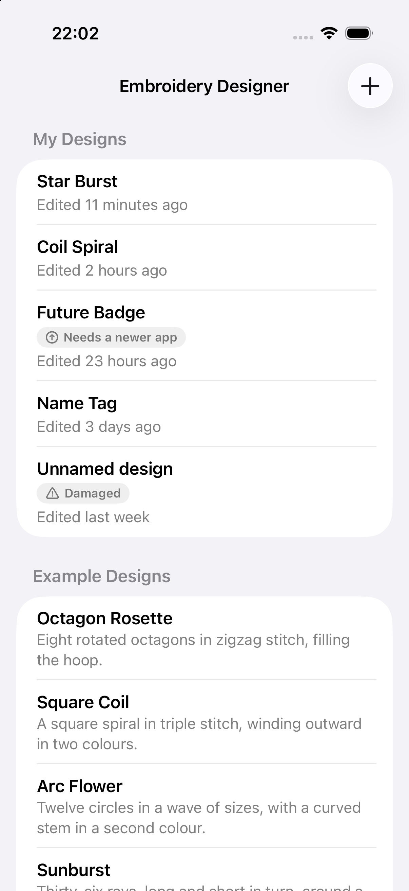
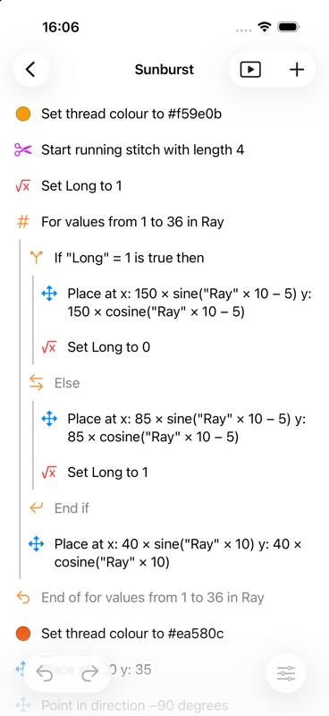
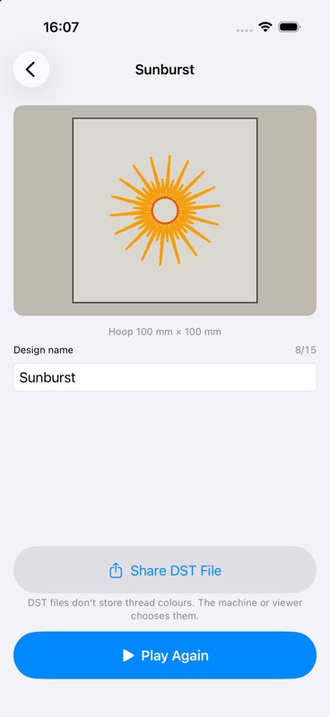

# catty-embroidery

[](https://github.com/stoneacher/catty-embroidery/actions/workflows/ci.yml)
[](https://github.com/stoneacher/catty-embroidery/actions/workflows/release-build.yml)

**Embroidery Designer for iOS** is a standalone native iOS app that brings
[Catrobat](https://catrobat.org)'s embroidery functionality to iOS. It is the iOS
counterpart of the "Embroidery Designer" flavor of Android
[Pocket Code](https://github.com/Catrobat/Catroid). You program a design with
Pocket Code-style bricks, watch the needle stitch it on a live stage, and export a
[Tajima DST](https://en.wikipedia.org/wiki/Tajima_(embroidery)) file that real
embroidery machines can read.

The app is a bachelor-thesis open-source contribution at TU Graz. It will be
transferred to the [Catrobat organization](https://github.com/Catrobat) after
sign-off. Like all Catrobat projects it is licensed under [AGPL-3.0](LICENSE).

<p align="center">
  
  
  
</p>

## Features

- **Brick editor.** Add bricks from a palette, reorder them, and edit their
  parameters with formula editors. Undo and redo cover every edit. Paired control
  bricks (loops, If/Else) move as one unit.
- **Bricks.**
  - Motion: Move N steps, Turn left/right, Point in direction, Place at, Set X/Y,
    Change X/Y by, Arc, Go through.
  - Embroidery: Stitch, Set thread colour, Running, Zigzag and Triple stitch, Sew up,
    Stop running stitch, Write embroidery to file.
  - Control: Repeat, Forever, Repeat until, For values from…to, Wait, Wait until,
    If, If/Else.
  - Data: Set variable, Change variable by.
- **Formulas.** Arithmetic, comparisons, logic, math functions (trigonometry,
  roots, rounding, logarithms, min/max, mod, …), constants, variables, and the
  object's own X, Y and direction.
- **Live stage.** The stitch preview draws thread and needle as the program runs,
  inside a 100 mm × 100 mm hoop. Zoom and pan are supported.
- **DST export.** Share the design as a `.dst` file through the share sheet or the
  Files app. The design name follows DST's 15-character limit and is checked as you
  type. The DST byte format is pinned by golden-file tests and has been checked in
  [Ink/Stitch](https://inkstitch.org).
- **Projects.** Create, rename, duplicate and delete designs. Every design is saved
  as its own versioned JSON file, and edits are autosaved. Files that are damaged, or
  that need a newer app, are flagged instead of being lost. The app ships with
  example designs: Octagon Rosette, Square Coil, Arc Flower and Sunburst.
- **Universal.** iPhone first, with an adaptive layout on iPad. All user-facing
  strings are in String Catalogs, ready for Catrobat's translations.

**Next up:** a smoother stage at 60 fps (US-316), then a runner for the
[Catrobat Language Tests](docs/ROADMAP.md#features-from-2026-10-09). The runner
needs a first, partial `.catrobat` importer.

## Architecture

The app is a thin SwiftUI layer (`@Observable` MVVM on `@MainActor`, no
architecture framework) on top of one Swift package,
[`Packages/EmbroideryEngine`](Packages/EmbroideryEngine). The package is
platform-independent and fully tested with `swift test`. Dependencies point inward
only:

| Target | Responsibility |
|---|---|
| `EmbroideryEngine` | Stitch model, stitch patterns, DST writer. Pure value types, no I/O. |
| `ProgramModel` | Program → scene → object → scripts → bricks; formulas as expression trees. This is the serialized format. |
| `Interpreter` | Runs a program headlessly and drives a virtual needle that produces the stitch stream. |
| `EditorCore` | The editor's vocabulary: brick kinds, palette, edit actions, undo stack, program document. |
| `StagePreview` | Display list, stage geometry, zoom/pan math (Foundation only). |
| `Samples` | Bundled example designs. |
| `Projects` | Project files on disk and the project library. This is the one target that does I/O. |

Swift 6 language mode with strict concurrency, iOS 17 minimum. The design decisions
are recorded as ADRs in [`docs/DECISIONS.md`](docs/DECISIONS.md); start with its
index. ADR-012 pins the byte-level DST semantics.

## Build & test

Requires Xcode 27 (CI pins Xcode 27.1 / Swift 6.4).

- **Engine:** `cd Packages/EmbroideryEngine && swift test`. No simulator needed.
- **App:** open `catrobat_embroidery_ios/catrobat_embroidery_ios.xcodeproj` in Xcode, or run
  ```sh
  xcodebuild -project catrobat_embroidery_ios/catrobat_embroidery_ios.xcodeproj \
    -scheme catrobat_embroidery_ios \
    -destination 'platform=iOS Simulator,name=iPhone 17' test
  ```
- **Lint:** `swiftlint` from the repository root (configured in `.swiftlint.yml`).

CI runs the engine tests, SwiftLint, the app build and tests, and a
Release-configuration device compile. All four must pass before a pull request can
merge.

## Contributing

The project is built test-first (TDD, [Swift Testing](https://developer.apple.com/xcode/swift-testing/)
only), one feature per branch and pull request. Before you start, read:

- [`docs/ROADMAP.md`](docs/ROADMAP.md): epics, milestones, feature status, engineering standards
- [`docs/DECISIONS.md`](docs/DECISIONS.md): architecture decision records
- [`docs/features/`](docs/features/): one brief per feature (the work since M4);
  [`docs/user-stories/`](docs/user-stories/) holds M1–M4 and the
  [backlog](docs/user-stories/backlog.md), which includes starter tasks
- [`CLAUDE.md`](CLAUDE.md) / [`AGENTS.md`](AGENTS.md): process rules for AI coding agents

## References

- [Catroid](https://github.com/Catrobat/Catroid): the canonical embroidery semantics
  (`org.catrobat.catroid.embroidery`)
- [Catty](https://github.com/Catrobat/Catty): iOS prior art and golden DST fixtures.
  It has known byte-level bugs, which ADR-012 lists and which this project does not
  port.

Concepts are ported, not code. Where data is ported verbatim (e.g. the DST conversion
table), its provenance is noted beside it.
